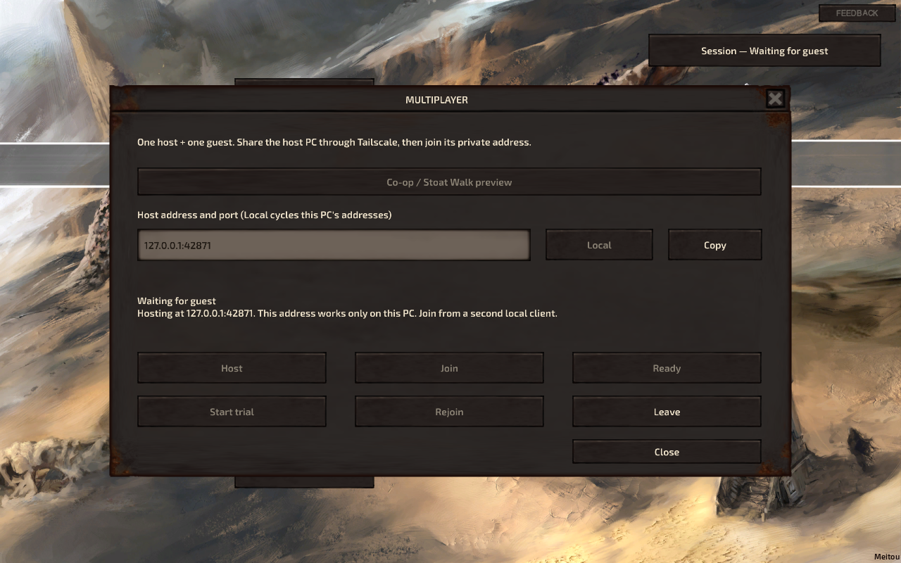
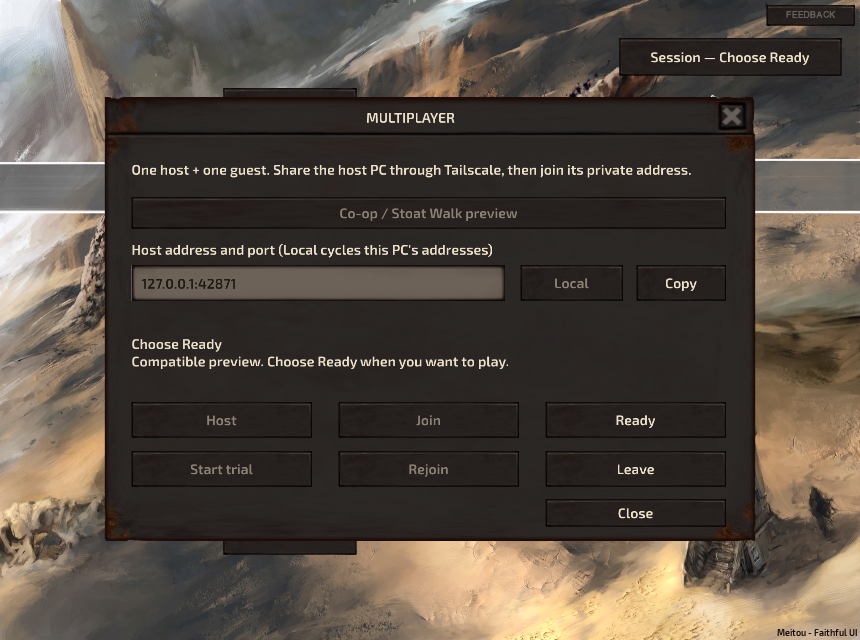
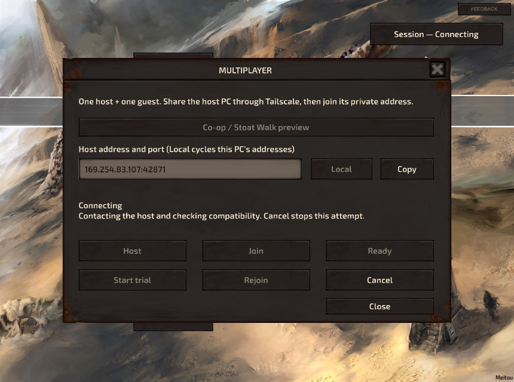
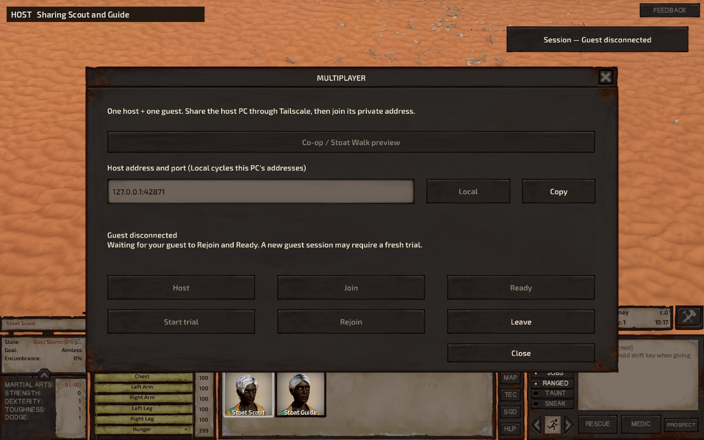
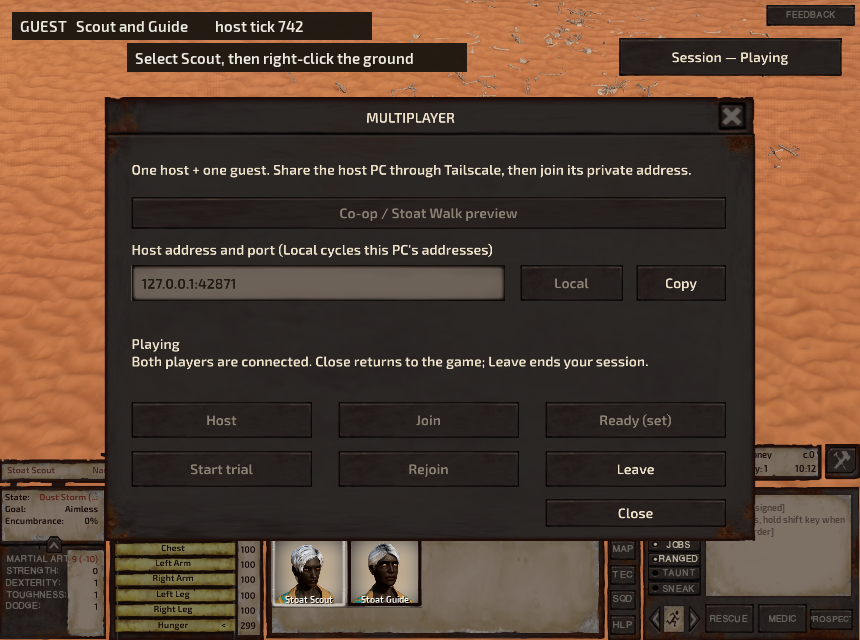

# Host/Join status visual checks

25 November 2026. Stock Windows Meitou 0.22.1, two isolated loopback clients using the 0.2.0 preview's Co-op and fixture with the new connector DLL. No original trial package or remote-host profile was modified.

Coordinate clicks through Meitou's input test channel exercised opening Multiplayer, connection cancellation, Host, Join, Ready, Start, Leave and a fresh guest join. Captures were inspected at 1280x800 and 860x640. Both Meitou and Faithful profile settings were exercised; the Multiplayer panel uses the native MyGUI layout in both.

| State | Observed result |
| --- | --- |
| Idle | Setup guidance fits; Host and Join available. |
| Connecting | Explicit progress and Cancel instruction fit at 860x640. |
| Waiting for guest | Listening host is no longer labelled disconnected; loopback guidance identifies same-PC use. |
| Choose Ready / Waiting for host | Guest has an actionable instruction, then waits for host Start. |
| Ready to start | Host Start becomes available after guest Ready. |
| Loading | Stock loading screen replaces the lobby during asset loading. Lobby communication continues; the preparation message is not continuously visible during this transition. |
| Playing | Both clients reach play; the small guest panel clearly distinguishes Close from Leave. |
| Guest disconnected | Host remains listening and explains rejoin versus a fresh trial. |
| Connection lost | Guest recovery controls and EOF detail fit at 860x640 in Faithful mode. |
| Trial stopped | Host explanation remains accessible after returning to the main menu. |

The visual pass caught guest recovery wording that incorrectly instructed the guest to Host. It was corrected to ask the host for a fresh session, then Join and Ready. Loopback waiting guidance was also corrected. Automated coverage includes the guest recovery instruction.

Existing recovery timing limitation: during the final fresh-guest admission check, the host stopped and retained its fresh-trial explanation, but the guest received EOF before receiving the restart reply and displayed Connection lost. The earlier run received the restart reply on both sides. This presentation-only change does not alter that shutdown race. The corrected guest-specific stopped wording is covered by the automated test; the final visual capture covers the EOF fallback instead.

31 transport/lobby/presentation checks passed, including readiness, incompatible builds/modes/files, cancellation, occupied port, second guest, disconnect and reconnect. The connector builds against stock 0.22.1 without warnings. This is UI validation, not another remote playtest or a new movement acceptance run. Unreachable-host detail wrapping, every possible OS error, and arbitrary window sizes are not exhaustively checked.

The original `Meitou-Stoat-Walk-0.2.0-preview.zip` remains byte-identical: SHA-256 `9848BCC09A13FB43A901321D015A35A5E98EB52776B78EFDE2DFBA807283A970`. Screenshots depict game assets and follow the gameplay-capture exclusion in [LICENSING.md](../LICENSING.md); they are not CC0 guides.
